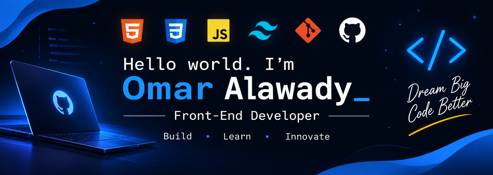

### Front-End Developer | MIS Student

---

## 👋 About Me

Hello! I'm **Omar Alawady**, a Front-End Developer and a Management Information Systems student.

I'm passionate about creating modern, responsive, and user-friendly web experiences.

- 🎓 Studying Management Information Systems.
- 💻 Focused on Front-End Development.
- 🌱 Always learning and improving my skills.
- 🚀 Building projects to turn ideas into real websites.
- 🎯 Open to Front-End Internship and Junior opportunities.

---

## 🧰 My Tech Stack

  

---

## 🚀 Featured Projects

### 🛒 ElectrOmar Store

An electronics store website built with Front-End technologies.

- 🌐 [Live Demo](https://omaralawadyy.github.io/electromar-store/)
- 💻 [GitHub Repository](https://github.com/OmarAlawadyy/electromar-store)

### 🌐 Personal Portfolio

My personal website to showcase my skills and projects.

- 🌐 [Live Website](https://omaralawadyy.github.io)
- 💻 [GitHub Repository](https://github.com/OmarAlawadyy/OmarAlawadyy.github.io)

---

## 📊 GitHub Analytics

---

## 🌍 Languages

- 🇪🇬 Arabic — Native
- 🇬🇧 English — Fluent
- 🇮🇹 Italian — Intermediate

---

## 📬 Let's Connect

  
  

### 💜 Dream. Code. Build. Grow.

*Thanks for visiting my GitHub profile!*

